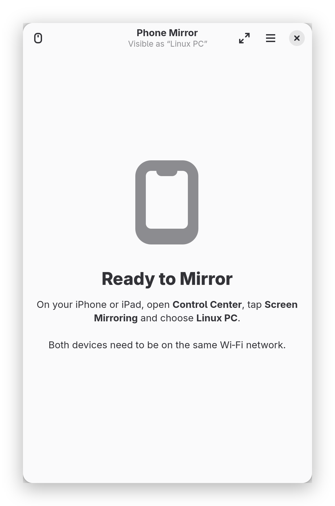

<div align="center">


# Phone Mirror

**Mirror your iPhone or iPad to Linux, and control it with your mouse and keyboard.**

Uses AirPlay, the Screen Mirroring button already on your iPhone, so there's no app to install on the
phone, no cable and no account. Low-latency video in a clean GNOME window.

[](LICENSE)


[](https://github.com/voidrlm/phone-mirror/releases)

[Install](#install) · [How to use](#how-to-use) · [Control your iPhone](#control-your-iphone-from-the-computer) · [Troubleshooting](#troubleshooting)



</div>

## Install

Paste this into a terminal:

```sh
curl -fsSL https://raw.githubusercontent.com/voidrlm/phone-mirror/main/install.sh | bash
```

Phone Mirror appears in your app grid. The installer adds [UxPlay](https://github.com/FDH2/UxPlay) (the
open-source AirPlay receiver) and the GStreamer video packages. It asks for your password once, installs
the app for your user only in `~/.local/opt/phone-mirror`, and updates it when you run it again.

**Runs on:** Fedora 41+, Ubuntu 24.10+, Debian 13+, Arch Linux and other distributions with libadwaita 1.6
or newer. On Arch, UxPlay comes from the AUR; the installer uses `paru` or `yay` if you have one.

<details>
<summary>Other ways to install</summary>

**From a clone:**

```sh
git clone https://github.com/voidrlm/phone-mirror.git
cd phone-mirror && ./install.sh
```

**By hand:** install these, then run `./phone-mirror`.

| Distribution | Packages |
|---|---|
| Fedora | `sudo dnf install python3-gobject gtk4 libadwaita gstreamer1-plugins-good gstreamer1-plugins-bad-free gstreamer1-plugin-gtk4 gstreamer1-plugin-libav uxplay python3-dbus` |
| Ubuntu / Debian | `sudo apt install python3-gi gir1.2-gtk-4.0 gir1.2-adw-1 gir1.2-gstreamer-1.0 gir1.2-gst-plugins-base-1.0 gstreamer1.0-plugins-good gstreamer1.0-plugins-bad gstreamer1.0-gtk4 gstreamer1.0-libav uxplay python3-dbus` |
| Arch | `sudo pacman -S python-gobject gtk4 libadwaita gst-plugins-good gst-plugins-bad gst-plugin-gtk4 gst-libav python-dbus` and `uxplay` from the AUR |

</details>

## How to use

1. Open **Phone Mirror** on your computer.
2. On your iPhone or iPad, open **Control Center** → **Screen Mirroring** and pick your computer's name.
3. That's it. The phone's screen appears in the window, sized exactly to the phone, with no black borders.

Both devices need to be on the same Wi-Fi network. Press <kbd>F11</kbd> or the fullscreen button to fill the screen.

## Features

- **Low delay.** The picture and sound play the instant they arrive, using a decoder that doesn't hold frames back. Good for demos, presentations and games.
- **Up to 1440p at 60 fps.** Choose the quality to suit your Wi-Fi.
- **Phone audio** plays through your computer, or turn it off.
- **Optional 4-digit code,** so nobody else on the network can mirror to your screen.
- **Control the phone from your computer** over Bluetooth. [See below](#control-your-iphone-from-the-computer).
- **Native GNOME app** with light and dark styles, and a log viewer for when things go wrong.

## Control your iPhone from the computer

AirPlay only sends the picture. For control, Phone Mirror makes your computer act as a **Bluetooth mouse and
keyboard** for the phone. This is a standard iOS accessibility feature, so there's nothing to jailbreak.

1. Click the **mouse button** in the header bar.
2. On the iPhone, turn on **Settings → Accessibility → Touch → AssistiveTouch**. iOS only shows a pointer while it's on.
3. If asked, pair with **Phone Mirror** in the iPhone's Bluetooth settings.

Then click, drag, scroll and type straight into the phone. A right-click is a long press,
<kbd>Ctrl</kbd> works as <kbd>⌘</kbd>, and <kbd>Ctrl</kbd>+<kbd>H</kbd> goes Home. Buttons for Home and the app
switcher sit under the picture. **Trackpad mode** and **touch-style scrolling** are in Preferences.

This needs a Bluetooth adapter that supports Bluetooth Low Energy (almost every laptop has one) and `python3-dbus`.

## Troubleshooting

**My computer doesn't show up in Screen Mirroring.**
Check that both devices are on the same network, and that the network allows devices to see each other
(guest Wi-Fi often doesn't). The Avahi service must be running: `systemctl status avahi-daemon`. If you use a
firewall, allow UxPlay through it. Fedora Workstation's default firewall already does.

**The picture stays black.**
Open **Preferences → Use separate video window**. Menu → **Show Log** shows what the receiver is doing.

**The video stutters.**
Lower the video quality in Preferences, or move closer to the router. A 5 GHz network helps a lot.

**How do I uninstall it?**

```sh
curl -fsSL https://raw.githubusercontent.com/voidrlm/phone-mirror/main/install.sh | bash -s -- --uninstall
```

Settings stay in `~/.config/phone-mirror` unless you delete that folder.

## How it works

[UxPlay](https://github.com/FDH2/UxPlay) handles the AirPlay protocol and forwards the phone's H.264 video
to a local port. Phone Mirror decodes it with GStreamer and draws it in its own GTK 4 window. Control runs
over a Bluetooth LE "HID over GATT" peripheral registered with BlueZ (`hid_remote.py`).

## Contributing

Issues and pull requests are welcome. It's plain Python with no build step. Run `./phone-mirror` from a clone.

If Phone Mirror is useful to you, please ⭐ **star the repo**. It helps other people find it.

## License

[MIT](LICENSE). Phone Mirror runs [UxPlay](https://github.com/FDH2/UxPlay) (GPL-3.0) as a separate program.

Not affiliated with Apple. AirPlay, iPhone and iPad are trademarks of Apple Inc.
